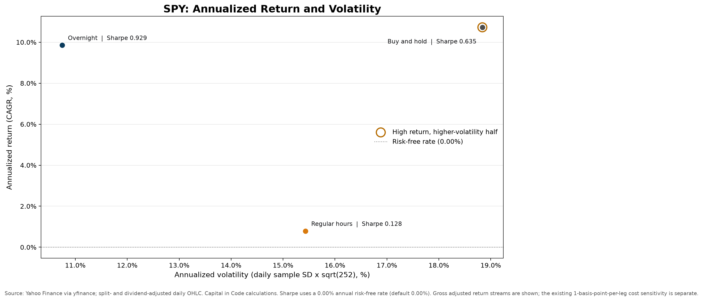

# CIC-001 Analysis Summary

This is the concise technical findings summary. For installation and
reproduction instructions, see the project [README](../README.md). For the
formal paper, see [research-report.md](../research-report.md).

## Research Question

From January 1994 through December 2025, did SPY historically produce more of
its return overnight—from the previous trading close to the current open—or
during regular hours from the current open to close?

The pre-analysis hypothesis was that the overnight component would account for
more of SPY's cumulative return.

## Data and Approach

The verified run downloaded SPY daily OHLC data from Yahoo Finance through
`yfinance` with `auto_adjust=True`. The same split- and dividend-adjustment
method was applied to Open and Close; raw and adjusted fields were not mixed.

The request covered 1994-01-01 through 2025-12-31. Available adjusted price data
ran from 1994-01-03 through 2025-12-31. Removing the first row without a
previous close left 8,053 aligned return observations from 1994-01-04 through
2025-12-31.

For each observed trading date `t`:

```python
overnight_return = open[t] / close[t - 1 trading observation] - 1
intraday_return = close[t] / open[t] - 1
close_to_close_return = close[t] / close[t - 1 trading observation] - 1
```

Dates were sorted and required to be unique. Missing, non-numeric, and
non-positive prices were counted and removed. The verified run had no invalid
rows. The compounded overnight and intraday returns reconstructed
close-to-close return with a maximum row-level discrepancy of
`2.22 × 10^-16`.

Annualized results use 252 trading days and a **0.00% annual risk-free rate**
when no rate is supplied. Win rate is the percentage of aligned return
observations above zero, not an order-level trade record.

## What the Data Shows

| Metric | Overnight | Regular hours | Buy and hold |
| --- | ---: | ---: | ---: |
| Mean daily return | 0.03962% | 0.00785% | 0.04748% |
| Median daily return | 0.06070% | 0.04775% | 0.07081% |
| Cumulative return | 1,917.13% | 28.63% | 2,494.63% |
| Annualized return | 9.86% | 0.79% | 10.73% |
| Annualized volatility | 10.75% | 15.43% | 18.84% |
| Sharpe ratio | 0.929 | 0.128 | 0.635 |
| Maximum drawdown | -32.79% | -68.49% | -55.19% |
| Positive return observations | 56.29% | 52.63% | 54.28% |

The same-period return and risk-adjusted rankings are:

| Return stream | Daily standard deviation | CAGR | Annualized volatility | Sharpe | Maximum drawdown | Win rate | Return rank | Sharpe rank | CAGR vs. buy and hold |
| --- | ---: | ---: | ---: | ---: | ---: | ---: | ---: | ---: | ---: |
| Overnight | 0.6769% | 9.86% | 10.75% | 0.929 | -32.79% | 56.29% | 2 | 1 | -0.87 pp |
| Regular hours | 0.9721% | 0.79% | 15.43% | 0.128 | -68.49% | 52.63% | 3 | 3 | -9.94 pp |
| Buy and hold (benchmark) | 1.1867% | 10.73% | 18.84% | 0.635 | -55.19% | 54.28% | 1 | 2 | 0.00 pp |

Return rank sorts by CAGR; Sharpe rank sorts by annualized Sharpe. Overnight is
the strongest return stream on a risk-adjusted basis, while buy and hold has
the highest CAGR. Buy and hold is flagged because it ranks in the upper half by
CAGR and higher half by annualized volatility. These are ex-post gross adjusted
returns; the existing 1 bp-per-leg cost sensitivity is separate.



*Sharpe uses the default 0.00% annual risk-free rate. The outlined point marks
the high-return, higher-volatility flag.*

The overnight-minus-intraday difference in mean daily return was 3.18 basis
points. A paired t-test gave `p = 0.0160`, a Wilcoxon signed-rank test gave
`p = 0.000162`, and a 10,000-sample paired bootstrap put the 95% interval for
the mean difference at 0.55 to 5.74 basis points per day.

Simple returns compound rather than add. The $1 ending values were $20.17 for
overnight, $1.29 for regular hours, and $25.95 for close-to-close buy and hold.

## Robustness

The overnight annualized return remained above the regular-hours result when
the sample began in 2000, 2010, or 2020. The gap narrowed in the more recent
windows:

| Sample start | Overnight | Regular hours |
| --- | ---: | ---: |
| Full sample | 9.86% | 0.79% |
| 2000 | 6.96% | 1.01% |
| 2010 | 8.62% | 4.89% |
| 2020 | 8.71% | 5.66% |

Removing any paired date where either component fell outside its own 1st-to-
99th-percentile range removed 284 observations. The retained dates compounded
to 3,746.17% overnight and 11.76% during regular hours, so the full-sample
result was not driven only by a few extreme observations.

The effect was not uniform across market regimes. During the defined COVID
shock from 2020-02-19 through 2020-03-23, overnight return was -28.12% versus
-7.34% during regular hours.

A hypothetical strategy charged 1 basis point on entry and 1 basis point on
exit every trading day. It reduced overnight annualized return from 9.86% gross
to 4.46% net and regular-hours return from 0.79% gross to -4.16% net. This model
still omits variable spreads, slippage, market impact, taxes, financing,
execution failures, and other operational constraints.

## What the Analysis Suggests

In this fixed adjusted-price sample, SPY's historical return was strongly
concentrated in the close-to-next-open interval. The overnight component had
the best Sharpe ratio among the three return streams and lower volatility and
shallower drawdown than regular hours. Buy and hold still had the highest CAGR.
The evidence supports the original return-decomposition hypothesis; it does
not show that an executable overnight strategy beats buy and hold after costs.

The start-date and tail checks suggest the result was broader than one chosen
start year or a handful of extreme dates. They do not show that the effect was
stable, causal, or guaranteed to persist.

## What the Analysis Cannot Establish

The analysis cannot determine why the pattern existed or prove that it will
continue. It cannot show that adjusted official Open and Close values were
available as executable prices in real time. The statistical tests simplify
serial dependence and changing volatility, and statistical significance does
not establish economic profitability.

## Practical Tradability

Practical tradability is **not established**.

The simplified 1-basis-point-per-leg overnight result remained positive, but
its 4.46% net annualized return was well below the 10.73% historical buy-and-
hold result. It also required daily entry and exit, idealized execution, and
ignored several large real-world frictions. A credible trading conclusion
would require timestamp-level executable prices, historical spreads and fees,
tax assumptions, and a more realistic execution model.

## Limitations

- Yahoo Finance may revise adjusted history, and `yfinance` is an unofficial
  interface.
- The adjustment convention affects how distributions are attributed between
  return components.
- Daily OHLC data does not establish executable prices, liquidity, or slippage.
- One ETF and one historical sample cannot establish a universal effect.
- Return distributions have fat tails and may be serially dependent.
- Market-period definitions are descriptive rather than causal.
- The transaction-cost model is intentionally simple and incomplete.
- Past performance does not predict future performance.

## Conclusion

The pre-analysis hypothesis was supported: SPY produced substantially more of
its adjusted historical return overnight than during regular hours from
1994-01-04 through 2025-12-31. The result was statistically detectable and
survived the selected robustness checks. It should be interpreted as a
historical decomposition, not evidence that a high-turnover overnight strategy
was superior, executable, or likely to work in the future.
